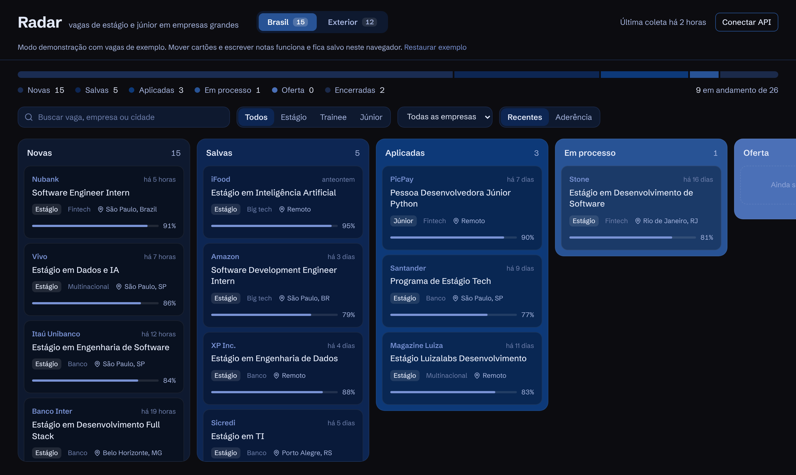

# Radar

Rastreador pessoal de vagas de **estágio, trainee, bolsa e júnior em desenvolvimento**, só em empresas grandes: big techs, bancos, fintechs e multinacionais. Ele coleta as vagas direto dos sistemas de recrutamento das empresas, filtra o que é de entrada e de tecnologia, separa o que é no Brasil do que é no exterior e organiza tudo num kanban de candidaturas.



## Como funciona

```
companies.yaml ──► coletor (GitHub Actions, a cada 4h)
                     │  adaptadores: Gupy · Greenhouse · Lever · Ashby · SmartRecruiters · Workday · Eightfold · Amazon
                     │  filtro por regras (nível + área de dev + Brasil/exterior)
                     │  IA opcional: casos ambíguos e nota de aderência ao perfil
                     ▼
                  Postgres ◄──── API FastAPI ◄──── Frontend Next.js (kanban)
```

**Sem scraping de LinkedIn.** As vagas vêm das APIs públicas que alimentam as próprias páginas de carreira das empresas (Gupy, Greenhouse etc.). É mais estável, respeita os termos de uso e traz o link oficial da candidatura.

**Só empresa grande, por construção.** O coletor só busca nas empresas listadas em [`backend/app/companies.toml`](backend/app/companies.toml). Para adicionar uma, basta descobrir o ATS dela pela URL da página de vagas (o arquivo explica como).

**Filtro em duas camadas.** Regras em [`classify.py`](backend/app/classify.py) resolvem a maioria dos títulos (`Estágio em Desenvolvimento` entra, `Senior Software Engineer` e `Estágio em Marketing` saem). Títulos ambíguos, como `Programa de Estágio 2027`, vão para um LLM, que também dá uma nota de 0 a 100 de aderência ao seu perfil com o motivo em uma frase. A IA é opcional e tem limite de chamadas por coleta.

**Remoto.** Cada vaga é marcada como remota pelo campo do próprio ATS ou por termos como "remoto", "home office" e "anywhere" no título e no local. Híbrido não conta. No site, o filtro "Só remoto" vem ligado.

**Prazo de inscrição.** Quando a fonte informa (a Gupy informa), o cartão mostra quanto falta e dá para ordenar pelo prazo mais próximo.

**Vagas encerradas.** Quando uma vaga some da fonte, ela é marcada como encerrada. Se você já estava no processo, ela continua no board com o aviso.

## Rodando localmente

Backend (Python 3.12 ou 3.13, 64 bits; versões mais novas podem não ter pacotes prontos no Windows):

```bash
cd backend
python -m venv .venv && source .venv/bin/activate
pip install -r requirements.txt
cp .env.example .env               # ajuste ADMIN_TOKEN
python scripts/check_sources.py    # testa as fontes do companies.toml
python -m app.collect              # primeira coleta (SQLite local)
uvicorn app.main:app --reload      # API em http://localhost:8000/docs
python -m pytest -q
```

Frontend (Node 22+):

```bash
cd frontend
npm install
echo "NEXT_PUBLIC_API_URL=http://localhost:8000" > .env.local
npm run dev                        # http://localhost:3000, depois "Conectar API" com o ADMIN_TOKEN
```

Sem `NEXT_PUBLIC_API_URL`, o frontend abre em **modo demonstração** com vagas de exemplo, que é o que vai para o portfólio. `STATIC_EXPORT=1 npm run build` gera essa versão como site estático em `out/`.

## Deploy

| Parte | Onde | Observação |
| --- | --- | --- |
| Banco | Neon ou Supabase (Postgres gratuito) | cole a URL em `DATABASE_URL` |
| API | Render, Railway ou Fly | `uvicorn app.main:app --host 0.0.0.0 --port $PORT` |
| Coletor | GitHub Actions ([`collect.yml`](.github/workflows/collect.yml)) | secrets `DATABASE_URL` e `ANTHROPIC_API_KEY` |
| Frontend | Vercel | variável `NEXT_PUBLIC_API_URL` |

## Estrutura

```
backend/
  app/sources/      um adaptador por ATS, todos devolvendo RawJob
  app/classify.py   regras de nível, área e região
  app/ai.py         camada de IA (opcional)
  app/collect.py    orquestra coleta, filtro, upsert e encerramento
  app/main.py       API REST
  tests/            regras, parsers com payloads reais e fluxo coleta→API
frontend/
  src/components/   board, colunas, cartões, painel de detalhes
  src/lib/store.ts  dados da API ou do modo demonstração
```

## Próximos passos

- Notificação no Telegram ou WhatsApp quando aparecer vaga com aderência alta
- Mais fontes: Google Careers e Cia de Talentos (programas de estágio de bancos e multinacionais)
- Versão em inglês da interface
